<div align="center">

# 🍢 도전! 분식왕

**손님 주문 받고 · 요리하고 · 서빙하고 · 치우고!**<br>
Java 소켓으로 만든 1인/2인 실시간 분식집 운영 게임


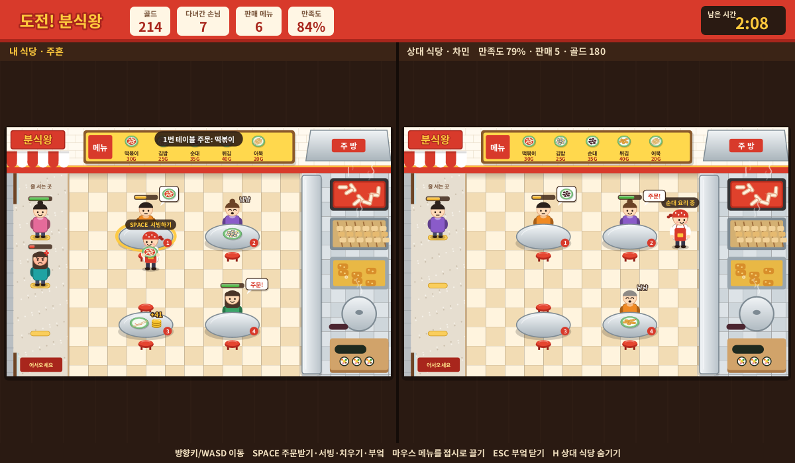

<sub>한성대학교 컴퓨터공학부 네트워크 프로그래밍 텀프로젝트 · 팀 <b>회사랑</b> (이주흔, 문차민)</sub>

</div>

---

## 목차

1. [게임 소개](#1-게임-소개)
2. [스크린샷](#2-스크린샷)
3. [게임 방법](#3-게임-방법)
4. [빠른 시작](#4-빠른-시작)
5. [설정 파일과 Git 제외 파일](#5-설정-파일과-git-제외-파일)
6. [프로젝트 구조](#6-프로젝트-구조)
7. [전체 구조와 흐름](#7-전체-구조와-흐름)
8. [밸런스 조절하기](#8-밸런스-조절하기)
9. [MVP 범위와 앞으로 할 일](#9-mvp-범위와-앞으로-할-일)
10. [팀과 사용한 자료](#10-팀과-사용한-자료)

---

## 1. 게임 소개

동네 분식집 사장님이 되어 제한 시간(3분) 동안 손님을 최대한 만족시키는 게임입니다.
손님은 입구에서 줄을 서고, 빈 테이블에 앉아 주문하고, 음식을 받으면 먹고 떠납니다.
사장님은 주문을 받고, 부엌에서 요리하고, 서빙하고, 손님이 남긴 빈 그릇을 치워 골드를 얻습니다.

| 모드 | 설명 |
|---|---|
| **혼자 하기 (1P)** | 내 식당 하나를 운영하며 최고 기록에 도전합니다. |
| **경쟁 하기 (2P)** | 두 노트북이 서버에 접속해 각자 식당을 운영합니다. 화면을 반으로 나눠 상대 식당이 실시간으로 보이며, 두 식당에는 **똑같은 순서의 손님**이 와서 실력으로만 승부가 납니다. |

**승리 기준(2P)**: 손님 만족도가 높은 쪽이 이깁니다. 만족도가 같으면 판매한 메뉴 수가 많은 쪽, 그것도 같으면 무승부입니다.

이 게임의 핵심 구조는 **"서버 1개 + 클라이언트 2개"** 입니다. 서버가 시간, 손님, 점수, 승패를 모두 계산하고, 클라이언트는 플레이어의 행동을 서버에 보내고 서버가 알려 준 상태를 화면에 그립니다.

---

## 2. 스크린샷

> 지금 화면의 그림은 모두 **코드로 직접 그린 임시 그래픽**입니다(외부 이미지 없음). 나중에 이미지로 교체할 예정입니다.

| 시작 화면 | 경쟁 모드 대기실 |
|:---:|:---:|
| 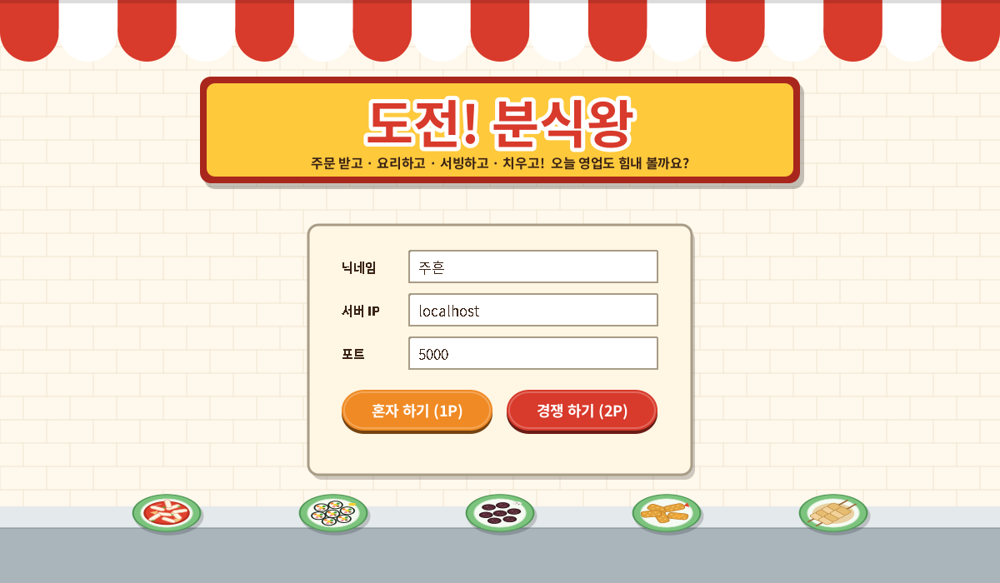 | 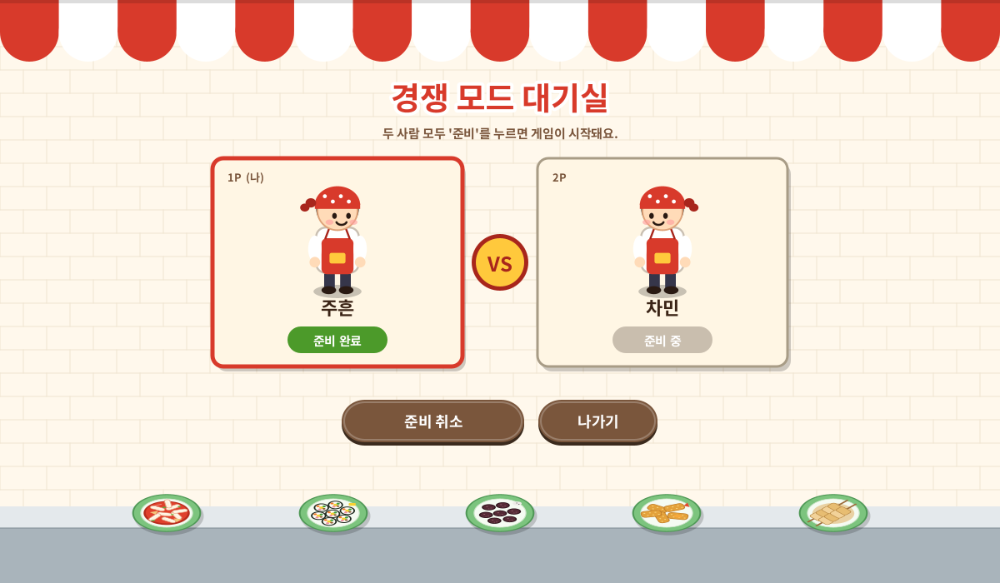 |
| **혼자 하기 (1P)** | **시작 카운트다운** |
| 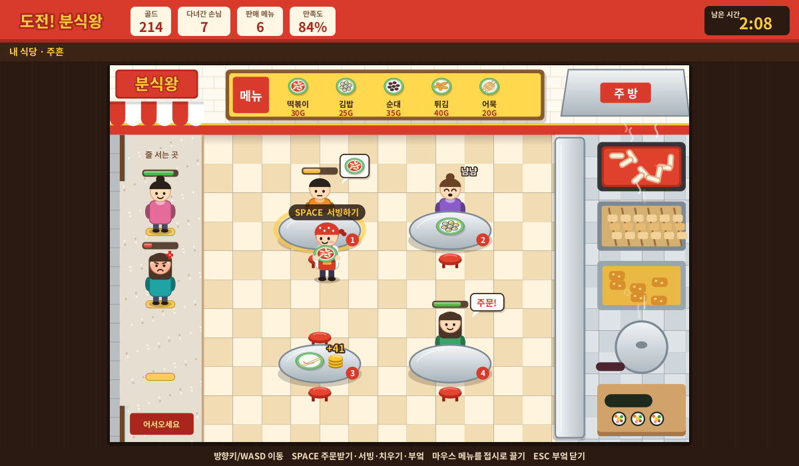 | 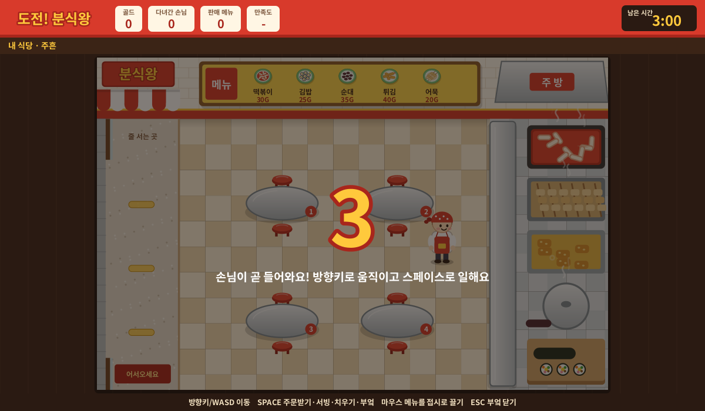 |
| **부엌: 메뉴를 접시로 끌어다 놓기** | **조리 중 (접시 둘레 진행 링)** |
| 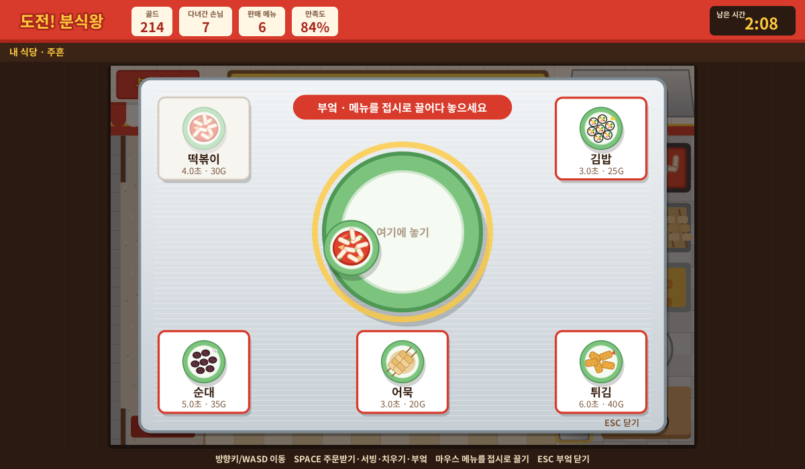 | 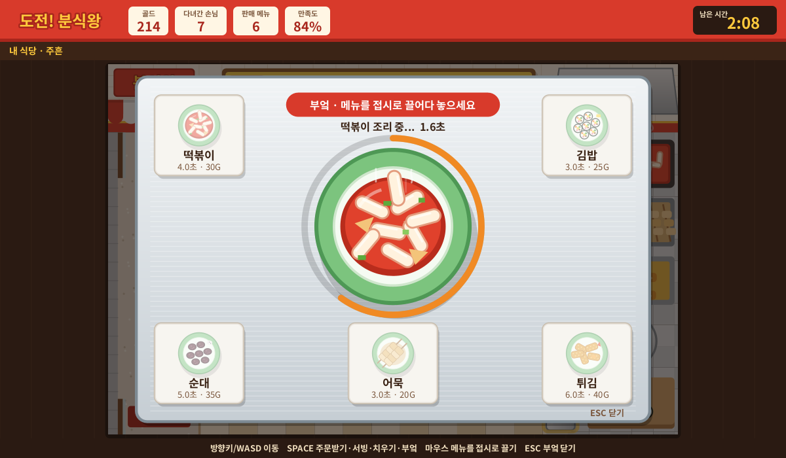 |
| **요리 완료** | **결과 화면** |
| 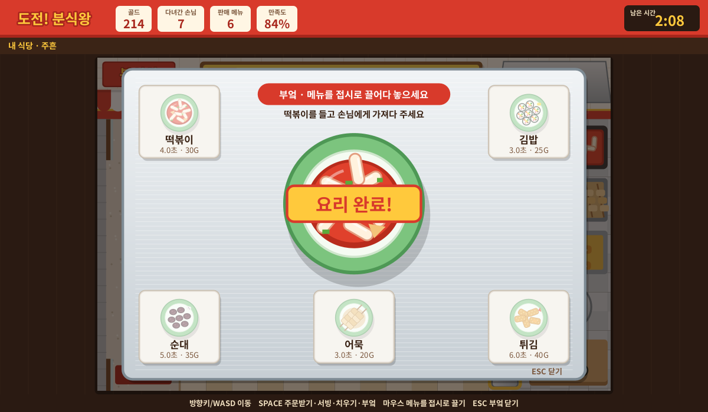 | 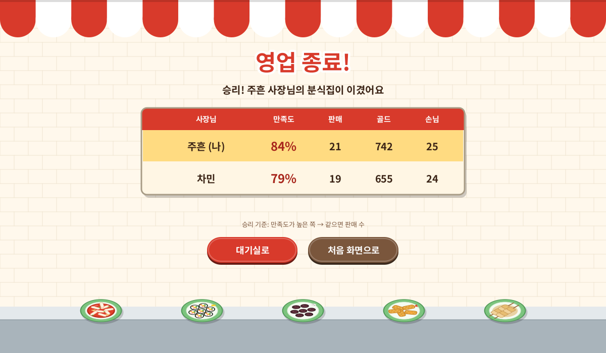 |

---

## 3. 게임 방법

### 3-1. 영업 흐름

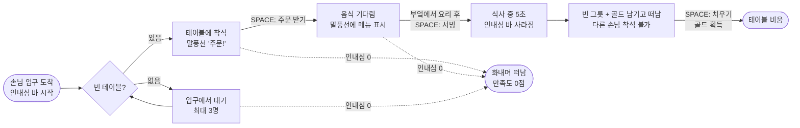

1. **주문 받기**: 손님이 앉은 테이블(말풍선 "주문!")에 다가가 `SPACE`를 누르면 주문을 받습니다. 말풍선에 주문한 메뉴가 나타납니다.
2. **조리**: 오른쪽 부엌 조리대에 다가가 `SPACE`를 누르면 부엌 화면이 열립니다. 모서리의 메뉴 카드를 **마우스로 끌어 가운데 접시에 놓으면** 조리가 시작되고, 메뉴마다 정해진 시간이 지나면 "요리 완료!"가 뜨면서 그릇을 든 채로 부엌 화면이 닫힙니다.
3. **서빙**: 그 메뉴를 주문한 테이블에 다가가 `SPACE`를 누르면 손님이 음식을 받습니다. 다른 메뉴를 들고 가면 서빙되지 않습니다.
4. **치우기**: 손님이 다 먹고 떠난 테이블(빈 그릇 + 골드)에 다가가 `SPACE`를 누르면 "청소 완료!"와 함께 골드를 얻고, 다음 손님이 앉을 수 있게 됩니다.

> 캐릭터 머리 위에 "SPACE 서빙하기"처럼 **지금 스페이스를 누르면 무슨 일이 일어나는지** 안내가 뜹니다. 손이 닿는 테이블과 부엌은 노란 테두리로 반짝입니다.

### 3-2. 조작법

| 키 / 마우스 | 동작 |
|---|---|
| `←` `↑` `↓` `→` 또는 `W` `A` `S` `D` | 캐릭터 이동 |
| `SPACE` | 가까운 곳에 따라 **주문 받기 · 서빙 · 치우기 · 부엌 열기** |
| `SPACE` (부엌에서 그릇을 든 상태) | 들고 있던 음식 버리기(손님이 떠나 버린 음식 처리용) |
| 마우스 끌어 놓기 | 부엌 화면에서 메뉴 카드 → 접시 (= 요리 시작) |
| `ESC` | 부엌 화면 닫기 (조리 중에는 닫을 수 없음) |
| `H` | (2P) 상대 식당 숨기기 / 보기 |
| 마우스 클릭 | 시작 화면 · 대기실 · 결과 화면의 버튼 |

### 3-3. 손님과 인내심

- 손님은 **입구에 도착한 순간**부터 머리 위에 인내심 바가 생깁니다.
- 바는 하나이며, 자리를 기다릴 때, 주문을 기다릴 때, 음식을 기다릴 때 **계속 줄어듭니다**. 음식을 받으면 바가 사라집니다.
- 바 색깔과 손님 표정이 함께 변합니다: 초록(웃음) → 노랑(무표정) → 빨강(화남).
- 바가 0이 되면 손님은 화를 내며 떠나고 만족도 0점으로 기록됩니다.
- 입구 대기줄(최대 3명)이 꽉 찬 상태에서 새 손님이 오면 그냥 지나갑니다.

### 3-4. 메뉴와 점수

| 메뉴 | 조리 시간 | 기본 가격 |
|---|---|---|
| 떡볶이 | 4초 | 30G |
| 김밥 | 3초 | 25G |
| 순대 | 5초 | 35G |
| 튀김 | 6초 | 40G |
| 어묵 | 3초 | 20G |

- **골드** = 기본 가격 + 기본 가격 × 0.5 × (서빙 순간 남은 인내심 비율). 빨리 서빙할수록 팁이 많습니다. 골드는 테이블을 치울 때 들어옵니다.
- **손님 만족도** = 떠난 손님들 점수의 평균. 서빙받은 손님은 서빙 순간 남은 인내심(%)이 점수가 되고, 화나서 떠난 손님은 0점입니다.
- 상단 표시줄에는 **골드, 다녀간 손님 수(화나서 떠난 손님 포함), 판매한 메뉴 수, 만족도, 남은 시간**이 표시됩니다.

---

## 4. 빠른 시작

### 4-1. 준비물

- **JDK 17 이상** (터미널에서 `java -version`, `javac -version`으로 확인)
- 외부 라이브러리와 빌드 도구는 필요 없습니다. 순수 Java(Swing + Socket)만 사용합니다.

### 4-2. 내려받기와 빌드

```bash
git clone https://github.com/<팀계정>/bunsik-king.git
cd bunsik-king
```

| | Windows | macOS / Linux |
|---|---|---|
| 빌드 | `build.bat` | `./build.sh` |
| 서버 실행 | `run-server.bat` | `./run-server.sh` |
| 클라이언트 실행 | `run-client.bat` | `./run-client.sh` |

> 실행 스크립트는 `out/` 폴더가 없으면 자동으로 먼저 빌드합니다. **코드를 고친 뒤에는 빌드를 다시** 해 주세요.

### 4-3. 혼자 하기 (노트북 1대)

1. 서버를 실행합니다.
2. 클라이언트를 실행하고, 닉네임을 입력한 뒤 서버 IP는 `localhost` 그대로 두고 **혼자 하기**를 누릅니다.

### 4-4. 경쟁 하기 (노트북 2대)

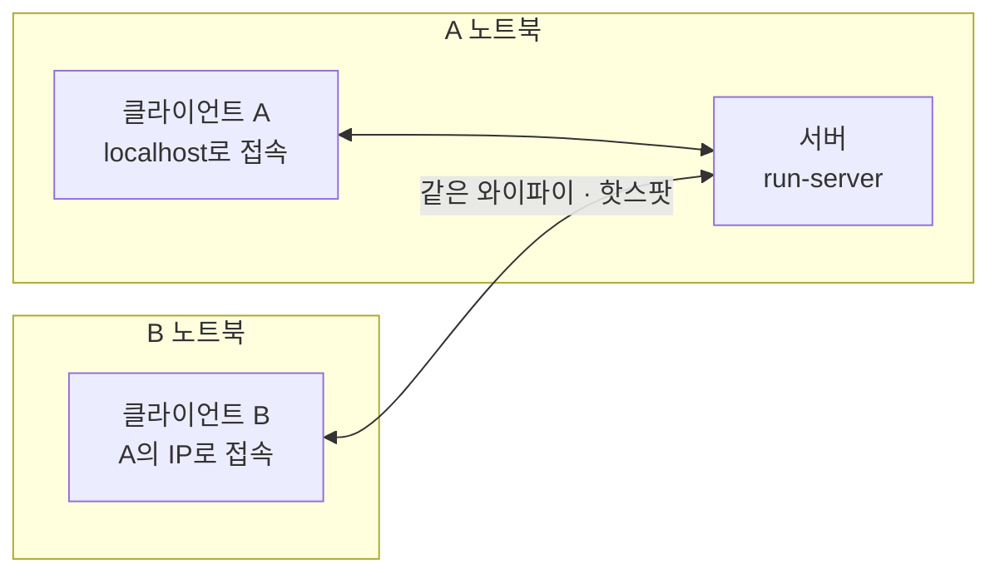

1. **A 노트북**에서 서버를 실행합니다. 서버 창에 **다른 노트북에서 입력할 IP 목록**이 출력됩니다.
2. A 노트북에서 클라이언트를 실행하고, 서버 IP `localhost`로 **경쟁 하기**를 누릅니다.
3. **B 노트북**에서 클라이언트를 실행하고, 서버 IP에 1번에서 본 A의 IP(예: `192.168.0.12`)를 입력한 뒤 **경쟁 하기**를 누릅니다.
4. 대기실에서 두 사람 모두 **준비**를 누르면 3초 카운트다운 후 시작합니다.

> 노트북 1대로 시험할 때는 클라이언트를 두 개 띄우고 둘 다 `localhost`로 접속하면 됩니다.

### 4-5. IDE에서 실행하기

**IntelliJ IDEA**
1. `File > Open`으로 저장소 폴더를 엽니다.
2. `File > Project Structure > Project`에서 SDK를 17 이상으로 맞추고, `Modules`에서 `src` 폴더를 **Sources**로 지정합니다.
3. `bunsik.server.ServerMain`과 `bunsik.client.ClientMain`을 각각 실행합니다.
4. 실행 설정(Run Configuration)의 **Working directory는 저장소 최상위 폴더**여야 `config.properties`를 찾습니다. 클라이언트를 두 개 띄우려면 `Modify options > Allow multiple instances`를 켭니다.

**Eclipse**
1. `File > New > Java Project`에서 `Use default location`을 끄고 저장소 폴더를 고릅니다(JRE 17 이상).
2. `src`가 소스 폴더로 잡혔는지 확인하고, 위 두 클래스를 `Run As > Java Application`으로 실행합니다.

### 4-6. 연결이 안 될 때

| 증상 | 확인할 것 |
|---|---|
| "서버에 연결할 수 없어요" | 서버가 켜져 있는지, IP와 포트가 맞는지 확인합니다. |
| 같은 노트북에서는 되는데 다른 노트북에서 안 됨 | 서버 노트북 **방화벽**에서 Java를 허용합니다(Windows는 첫 실행 때 뜨는 허용 창에서 "개인 네트워크"를 체크). |
| 학교 와이파이에서만 안 됨 | 학교 와이파이는 기기끼리 통신을 막아 둔 경우가 많습니다. **휴대폰 핫스팟**에 두 노트북을 연결해 보세요. |
| "포트가 이미 사용 중" | 서버가 이미 켜져 있거나 다른 프로그램이 쓰는 중입니다. `run-server.bat 6000`처럼 다른 포트로 실행하고, 클라이언트 포트도 똑같이 맞춥니다. |

---

## 5. 설정 파일과 Git 제외 파일

### 5-1. 설정 파일 (`.env` 대신)

Java에는 `.env`를 쓰는 관례가 없어서, 같은 역할을 **두 개의 properties 파일**로 나눴습니다. 프로그램은 실행한 폴더에서 아래 순서로 읽고, 뒤의 값이 앞의 값을 덮어씁니다.

| 파일 | Git | 용도 |
|---|---|---|
| `config.properties` | 올림 | 팀 공용 기본값(포트 5000, `localhost`) |
| `config.local.properties` | **제외** | 내 노트북 전용 값(예: B 노트북이 접속할 A의 IP, 내 닉네임) |

`config.local.properties.example`을 복사해 이름을 `config.local.properties`로 바꿔 쓰면 됩니다. 비밀번호 같은 민감한 정보는 없지만, 사람마다 다른 IP가 공용 파일에 섞여 서로의 설정을 덮어쓰는 일을 막기 위해 분리했습니다.

```properties
# config.properties
server.port=5000
client.host=localhost
client.port=5000
client.nickname=
```

### 5-2. `.gitignore`에 넣은 것

| 항목 | 이유 |
|---|---|
| `out/`, `bin/`, `build/`, `*.class`, `*.jar`, `sources.txt` | 빌드하면 언제든 다시 생기는 결과물 |
| `.idea/`, `*.iml`, `.vscode/`, `.project`, `.classpath`, `.settings/` | 사람마다 다른 IDE 설정. 올리면 서로 충돌함 |
| `.DS_Store`, `Thumbs.db` | 운영체제가 자동으로 만드는 파일 |
| `config.local.properties`, `*.log` | 개인 설정(`.env` 역할)과 실행 기록 |

`.gitattributes`는 Windows와 Mac을 섞어 쓸 때 줄바꿈 문자 때문에 "아무것도 안 고쳤는데 파일 전체가 바뀐 것"으로 보이는 문제를 막습니다.

---

## 6. 프로젝트 구조

```text
bunsik-king/
├─ src/bunsik/
│  ├─ common/          ← 서버와 클라이언트가 함께 쓰는 "계약서"
│  │  ├─ MessageType.java
│  │  ├─ Message.java
│  │  ├─ StoreSnapshot.java
│  │  ├─ Menu.java
│  │  ├─ TableState.java
│  │  ├─ GameConfig.java
│  │  ├─ StoreLayout.java
│  │  └─ AppConfig.java
│  ├─ server/          ← 서버: 접속 관리, 대기실, 게임 진행 (GUI 없음)
│  │  ├─ ServerMain.java
│  │  ├─ GameServer.java
│  │  ├─ ClientHandler.java
│  │  ├─ VersusLobby.java
│  │  ├─ GameRoom.java
│  │  └─ game/         ← 게임 규칙 (화면·소켓을 모르는 순수 자바)
│  │     ├─ Store.java
│  │     ├─ Customer.java
│  │     ├─ Table.java
│  │     ├─ Chef.java
│  │     └─ CustomerSchedule.java
│  └─ client/          ← 클라이언트: 통신 + 화면
│     ├─ ClientMain.java
│     ├─ NetworkClient.java
│     ├─ ui/           ← 화면과 입력 처리
│     │  ├─ GameFrame.java
│     │  ├─ TitlePanel.java
│     │  ├─ LobbyPanel.java
│     │  ├─ GamePanel.java
│     │  ├─ KitchenOverlay.java
│     │  ├─ ResultPanel.java
│     │  └─ UiKit.java
│     └─ render/       ← 그림 그리기 (나중에 이미지로 교체할 곳)
│        ├─ StoreRenderer.java
│        └─ Sprites.java
├─ docs/screenshots/   ← README 이미지
├─ config.properties   ← 공용 설정
├─ config.local.properties.example
├─ build.sh / build.bat
├─ run-server.sh / run-server.bat
├─ run-client.sh / run-client.bat
├─ .gitignore
└─ .gitattributes
```

### 6-1. 파일별 역할

**`common` · 공통 (양쪽이 같은 정의를 써야 어긋나지 않는 것들)**

| 파일 | 역할 |
|---|---|
| `MessageType.java` | 주고받는 메시지 종류 목록과 각 메시지의 값 순서. 두 사람 작업의 계약서이므로 바꿀 때는 반드시 합의합니다. |
| `Message.java` | 메시지 한 줄을 만들고(`encode`) 해석하는(`parse`) 전담 클래스. 값 안의 구분자 `\|`를 다른 글자로 바꿔 메시지가 깨지는 것을 막습니다. |
| `StoreSnapshot.java` | 식당 하나의 "지금 상태" 전체(시간·점수·캐릭터·테이블·대기줄)와, 이를 STATE 메시지로 바꾸고 되돌리는 코드. |
| `Menu.java` | 메뉴 5종의 이름, 조리 시간, 가격. 받침에 맞는 조사(을/를)도 붙여 줍니다. |
| `TableState.java` | 테이블 상태 흐름: 비어 있음 → 주문 대기 → 음식 대기 → 식사 중 → 빈 그릇. |
| `GameConfig.java` | 제한 시간, 손님 간격, 인내심, 식사 시간 같은 **밸런스 숫자 모음**. |
| `StoreLayout.java` | 식당 배치도(테이블·대기줄·부엌 좌표)와 "가까이 있는지" 판정. 서버의 판정과 클라이언트의 그리기가 같은 좌표를 씁니다. |
| `AppConfig.java` | `config.properties` → `config.local.properties` 순서로 설정을 읽습니다. |

**`server` · 서버**

| 파일 | 역할 |
|---|---|
| `ServerMain.java` | 서버 시작점. 콘솔에 접속용 IP 목록을 보여 주고 서버를 켭니다. |
| `GameServer.java` | 포트에서 접속을 기다리는 "문지기". 접속마다 전담 스레드를 붙이고, 1P는 바로 게임방, 2P는 대기실로 보냅니다. |
| `ClientHandler.java` | 접속자 한 명을 전담하는 스레드. 메시지를 읽어 대기실이나 게임방 대기줄에 전달하고, 메시지 보내기는 한 번에 하나씩만 하도록 잠급니다. |
| `VersusLobby.java` | 2P 대기실(최대 2명). 입장·준비·퇴장을 실시간으로 알리고, 둘 다 준비되면 게임방을 만듭니다. |
| `GameRoom.java` | 한 판을 진행하는 방. 카운트다운 → 0.1초마다 게임 시계(행동 처리 → 규칙 계산 → STATE 전송) → 종료와 승패 계산. |
| `game/Store.java` | **게임 규칙의 핵심**. 손님 도착, 인내심, 착석, 주문, 조리, 서빙, 식사, 청소, 골드, 만족도를 계산합니다. |
| `game/Customer.java` | 손님 한 명(메뉴, 생김새, 도착 시각, 남은 인내심 계산). |
| `game/Table.java` | 테이블 한 개(상태, 앉은 손님, 놓인 골드). |
| `game/Chef.java` | 플레이어 캐릭터의 서버 쪽 상태(위치, 들고 있는 음식, 조리 중인 메뉴). |
| `game/CustomerSchedule.java` | 손님 "예약 명단". 2P에서는 두 식당에 같은 씨앗값을 줘서 똑같은 손님이 오게 합니다. |

**`client` · 클라이언트**

| 파일 | 역할 |
|---|---|
| `ClientMain.java` | 클라이언트 시작점. |
| `NetworkClient.java` | 서버 접속, 보내기, 받기 전담. 받은 메시지는 `SwingUtilities.invokeLater`로 화면 스레드에 넘깁니다. |
| `ui/GameFrame.java` | 창 하나. 시작 → 대기실 → 게임 → 결과 화면을 `CardLayout`으로 넘기고, 서버 메시지를 알맞은 화면에 전달합니다. |
| `ui/TitlePanel.java` | 시작 화면(닉네임·IP·포트 입력, 모드 선택). |
| `ui/LobbyPanel.java` | 2P 대기실 화면(입장 표시, 준비 버튼). |
| `ui/GamePanel.java` | 게임 화면. 키보드 이동, 위치 전송, 상단 표시줄, 화면 반 나누기, 안내 문구, 카운트다운. |
| `ui/KitchenOverlay.java` | 부엌 화면. 큰 접시와 모서리 메뉴 카드, 마우스 끌어 놓기, 조리 진행 링, "요리 완료!" 표시. |
| `ui/ResultPanel.java` | 결과 화면(승패와 성적표). |
| `ui/UiKit.java` | 분식집 색상표, 한글 글꼴 고르기, 둥근 버튼, 입력창 꾸미기. |
| `render/StoreRenderer.java` | 스냅샷 하나로 식당 전체를 그립니다(내 식당·상대 식당 공통). 위아래 겹침 순서와 "SPACE 서빙하기" 같은 안내도 여기서 그립니다. |
| `render/Sprites.java` | 바닥, 벽, 메뉴판, 입구, 부엌, 테이블, 음식, 캐릭터, 손님, 인내심 바 등 **모든 그림**. 외부 이미지로 바꿀 때는 이 파일만 고치면 됩니다. |

---

## 7. 전체 구조와 흐름

### 7-1. 서버 중심 구조

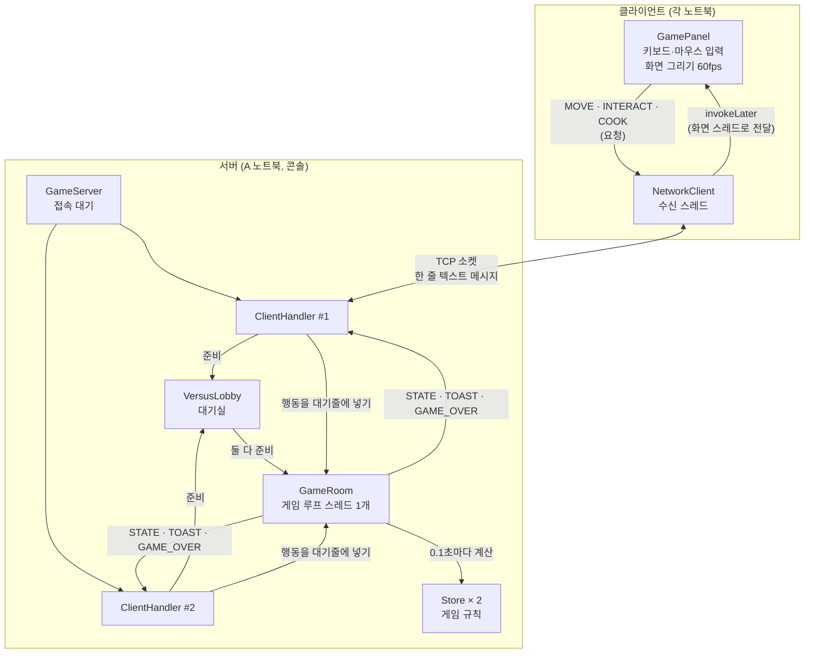

이 프로젝트를 이해하는 데 필요한 원칙은 다섯 가지입니다.

1. **판단은 서버, 표시는 클라이언트.** 클라이언트는 "3번 테이블에 서빙하고 싶다"는 요청만 보냅니다. 서버가 규칙상 가능한지 확인한 뒤 결과를 상태(STATE)로 알려 줍니다. 그래서 두 화면의 점수가 서로 달라지지 않습니다.
2. **이동만 예외.** 키보드 이동은 반응 속도가 중요하므로 내 화면에서 바로 움직이고, 위치는 바뀌었을 때만 최대 0.1초에 한 번 서버에 알립니다(매 프레임 보내면 네트워크가 막힙니다).
3. **한 줄 처리.** 서버에서 게임 상태를 바꾸는 스레드는 게임방의 게임 루프 **하나뿐**입니다. 접속자 스레드들은 행동을 대기줄에 넣기만 하므로, 여러 스레드가 동시에 같은 데이터를 고쳐 생기는 버그를 피할 수 있습니다.
4. **매번 전체 상태 전송.** 사건(손님 등장 등)만 보내지 않고 0.1초마다 식당 상태 전체를 보냅니다. 메시지 하나가 어긋나도 다음 상태가 바로잡아 줍니다.
5. **화면은 화면 스레드에서만.** 네트워크 수신 스레드가 Swing 화면을 직접 고치면 가끔 깨지는 버그가 생기므로, 반드시 `invokeLater`로 넘깁니다.

### 7-2. 스레드 구성

| 위치 | 스레드 | 하는 일 |
|---|---|---|
| 서버 | main | `ServerSocket.accept()`로 접속을 기다림 |
| 서버 | `client-N` (접속자마다 1개) | 그 사람의 메시지를 읽어 대기실·게임방에 전달 |
| 서버 | `game-room` (게임방마다 1개) | 카운트다운, 0.1초 게임 시계, 상태 계산과 전송 |
| 클라이언트 | Swing 화면 스레드(EDT) | 입력 처리, 이동, 그리기 (`javax.swing.Timer` 16ms) |
| 클라이언트 | `net-reader` | 서버 메시지를 받아 화면 스레드로 넘김 |
| 클라이언트 | `connector` | 접속(오래 걸릴 수 있어 화면이 멈추지 않게 따로) |

### 7-3. 한 판의 흐름 (2P)

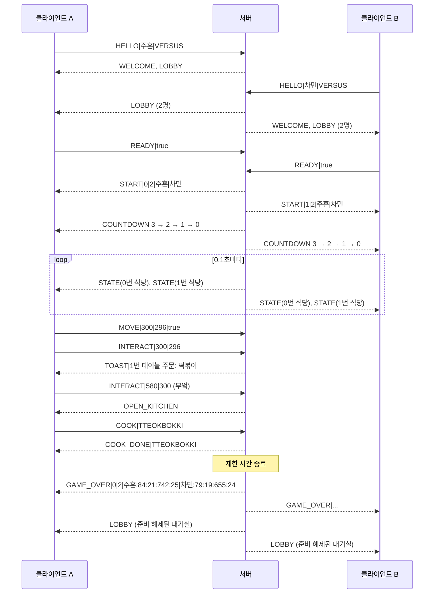

### 7-4. 통신 규칙

메시지는 **한 줄 텍스트**이며 `종류|값1|값2|...` 모양입니다(UTF-8, 줄바꿈으로 구분). 사람이 읽을 수 있어 디버깅이 쉽습니다.

| 방향 | 종류 | 값 | 설명 |
|---|---|---|---|
| C→S | `HELLO` | 닉네임 \| `SOLO`/`VERSUS` | 접속 인사, 모드 선택 |
| C→S | `READY` | `true`/`false` | 대기실 준비 버튼 |
| C→S | `MOVE` | x \| y \| 왼쪽보기 | 내 캐릭터 위치 |
| C→S | `INTERACT` | x \| y | 스페이스 키 |
| C→S | `COOK` | 메뉴코드 | 접시에 메뉴를 놓음 |
| C→S | `LEAVE` | - | 정상 종료 |
| C→S | `CHAT` | 본문 | 공백 치환·앞뒤 공백 제거 후 1~200 UTF-16 단위 |
| S→C | `CHAT` | 접속번호 \| 닉네임 \| 본문 | 서버가 확인한 발신자 정보로 중계 |
| S→C | `WELCOME` | 접속번호 | 접속 확인 |
| S→C | `REJECT` | 이유 | 입장 거절(대기실 가득 참 등) |
| S→C | `LOBBY` | 번호:닉네임:준비 … | 대기실 현황 |
| S→C | `START` | 내슬롯 \| 인원 \| 닉네임0 \| 닉네임1 | 게임 화면으로 전환 |
| S→C | `COUNTDOWN` | 3, 2, 1, 0 | 0이면 시작 |
| S→C | `STATE` | (아래 참고) | 식당 하나의 전체 상태 |
| S→C | `OPEN_KITCHEN` | - | 부엌 화면 열기 |
| S→C | `COOK_DONE` | 메뉴코드 | 요리 완료 |
| S→C | `TOAST` | 문구 | 화면에 잠깐 띄울 안내 |
| S→C | `GAME_OVER` | 승자 \| 인원 \| 닉네임:만족도:판매:골드:손님 … | 결과(승자 -1 무승부, -2 혼자 하기) |

**STATE 값 순서**

채팅 필드와 실행 방법은 [SPEC 4.3 채팅 규약과 실행 방법](SPEC.md#43-채팅-규약과-실행-방법)을 참고합니다.
현재 CHAT 구현은 독립 검증용 서버·창이며 게임방·게임 화면 연동은 후속 작업입니다.

```text
STATE | 슬롯 | 남은시간ms | 골드 | 다녀간손님 | 판매수 | 만족도(-1=아직없음)
      | 캐릭터x | 캐릭터y | 왼쪽보기 | 들고있는메뉴 | 조리중메뉴 | 조리남은ms | 조리전체ms
      | 테이블들  (상태:메뉴:인내심0~1000:골드:생김새 를 쉼표로)
      | 대기줄    (인내심:생김새 를 쉼표로, 비었으면 -)
```

예시:

```text
STATE|0|128000|214|7|6|84|300|296|true|TTEOKBOKKI|-|0|0|WAITING_FOOD:TTEOKBOKKI:520:0:3,EATING:GIMBAP:-1:0:8,DIRTY:-:-1:41:0,WAITING_ORDER:-:820:0:13|900:5,250:16
```

---

## 8. 밸런스 조절하기

숫자는 모두 `src/bunsik/common/GameConfig.java`와 `Menu.java`에 모여 있습니다. 여기만 고치고 다시 빌드하면 됩니다(서버와 클라이언트 모두).

| 설정 | 현재 값 | 의미 |
|---|---|---|
| `GAME_DURATION_MS` | 180000 | 한 판 시간(3분) |
| `TABLE_COUNT` | 4 | 테이블 수(바꾸면 `StoreLayout`의 좌표도 함께 수정) |
| `QUEUE_CAPACITY` | 3 | 입구 대기줄 최대 인원 |
| `ARRIVAL_GAP_MIN_MS` ~ `MAX_MS` | 4000 ~ 7000 | 손님 등장 간격 |
| `PATIENCE_MS` | 45000 | 손님 인내심(입장부터 서빙까지) |
| `EAT_MS` | 5000 | 식사 시간 |
| `TIP_RATE` | 0.5 | 팁 비율 |
| `PLAYER_SPEED` | 230 | 캐릭터 이동 속도 |

---

## 9. MVP 범위와 앞으로 할 일

### 9-1. 이번 MVP에 들어간 것

- [x] 서버 1개 + 클라이언트 2개 소켓 구조, 접속자별 스레드, 게임방 단일 루프
- [x] 1P(혼자 하기)와 2P(경쟁 하기). 1P도 서버를 거쳐 같은 코드로 동작
- [x] 2P 대기실: 실시간 입장 표시, 준비 버튼, 정원 2명, 3초 카운트다운
- [x] 핵심 영업 흐름: 주문 → 조리(마우스 끌어 놓기) → 서빙 → 식사 → 치우기·골드
- [x] 단일 인내심 바(입장~서빙), 표정 변화, 화난 손님 퇴장
- [x] 상단 표시줄(골드·다녀간 손님·판매 메뉴·만족도·남은 시간)
- [x] 2P 화면 반 나누기, 상대 식당 실시간 표시, 숨기기(`H`)
- [x] 공정한 경쟁(두 식당에 같은 손님 명단), 만족도 기준 승패와 결과 화면
- [x] 코드로 그린 분식집 임시 그래픽

### 9-2. 앞으로 할 일

**1차 기반 구축**
- [x] **채팅 기반 (주흔 jh)**: CHAT 규약·독립 서버·클라이언트 구현, 두 소켓 자동 검증 완료. 게임 화면 연동과 두 노트북 테스트는 후속 작업
- [x] **공통 메시지·설정 (주흔 jh)**: `MessageType`, `Message`, `AppConfig`, 설정 파일 구현 및 Java 21 대상 컴파일·자동 검증 완료. 서버 연동과 두 클라이언트 통신 검증은 서버 기반 작업 후 진행

**제안서 기능 중 아직 안 한 것**
- [ ] **오류 수정**: 2p 활동 중 H 키보드 작동 안함
- [ ] **게임 중 채팅**: 메시지 종류(`CHAT`) 추가, `Enter`로 입력창 열기, 보낸 뒤 게임 조작으로 포커스 되돌리기
- [ ] **이모티콘 채팅**: 이미지 대신 `:smile:` 같은 코드를 보내고 받는 쪽이 이미지로 바꿔 보여 주기
- [ ] **정식 연결 끊김 처리**: 상대에게 알림, 남은 사람 승리 처리 또는 대기실 복귀, 일시 정지 및 중단(시작 화면 복귀), 서버 종료 시 클라이언트 안내, 하트비트로 끊김 빨리 감지
  - 지금은 MVP 수준입니다. 나간 사람은 명단에서 빠지고, 남은 사람은 시간 끝까지 혼자 진행하며, 클라이언트는 끊기면 시작 화면으로 돌아갑니다.
- [ ] **서버 로그 정식화**: 시간 표시, 파일 저장, 게임 결과 기록, 관리자 명령(`status`, `quit` 등)
  - 지금은 접속·입장·시작·종료만 콘솔에 간단히 출력합니다.
- [ ] **단계별 난이도**: 단계마다 메뉴 수와 손님 간격을 설정 표로 관리, 2P에서 단계 상승 기준 정하기
- [ ] **VIP 손님**: 인내심은 낮고 골드는 많은 손님 종류(`Customer` 확장)
- [ ] **골드 상점·아이템**: 이동 속도, 요리 속도, 테이블 개수 강화. 구매 검증은 서버에서(골드 차감)

**그래픽·편의**
- [ ] **외부 이미지로 교체**: `Sprites.java`의 각 메서드를 `drawImage`로 바꾸고, 이미지는 `resources/` 폴더에 모아 **출처를 따로 정리**(과제 규정상 참고한 오픈소스는 구분해서 제출). jar에서도 그림이 나오도록 `getResource`로 읽기
- [ ] 손님 걷기 애니메이션(지금은 입구 → 테이블로 바로 이동)
- [ ] 1P 결과 화면에 "다시 하기" 버튼
- [ ] 효과음, 배경음(선택)

**품질·제출 준비**
- [ ] 두 노트북 실전 테스트 체크리스트: 동시 행동, 게임 중 창 닫기, 서버 먼저 끄기, 연속 재시작, 학교 와이파이와 핫스팟
- [ ] 서버의 위치 검증 강화(이동 속도 검사 등)
- [ ] 실행 파일(jar) 만들기와 실행 방법 정리
- [ ] 팀원별 담당 기능 정리와 시연 영상 준비(동영상 발표는 각자)

---

## 10. 팀과 사용한 자료

| 이름 | 담당 |
|---|---|
| 이주흔 | (작성 예정) |
| 문차민 | (작성 예정) |

- **외부 자료**: 현재 버전은 외부 이미지·코드를 사용하지 않습니다. 모든 그래픽은 `Sprites.java`에서 Java2D로 직접 그렸고, 게임 로직과 서버·클라이언트 네트워크 코드는 직접 작성했습니다.
- 외부 이미지를 추가하면 이 표에 출처를 기록합니다.

| 자료 | 출처 | 사용 위치 |
|---|---|---|
| (없음) | | |

<sub>본 저장소는 한성대학교 네트워크 프로그래밍 수업 텀프로젝트용입니다.</sub>
